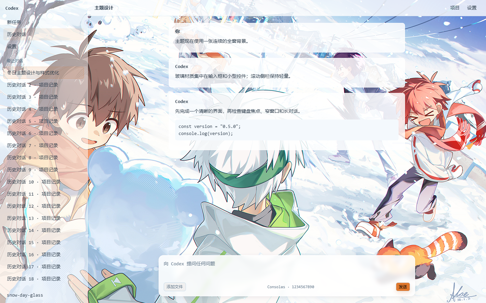

# Snow Day Glass

冬日雪仗氛围的 Codex 桌面主题：贯穿整个窗口的背景图、主要区块的轻量玻璃材质、
柔和的输入框阴影。原生 Codex 版本内嵌 [霞鹜文楷 GB](https://github.com/lxgw/LxgwWenKaiGB)
字体；Codex++ ZIP 使用 DreamSkin 支持的系统字体。



上图由真实上游 DreamSkin 渲染器在模拟工作区中生成，是设计预览。
ZIP 已通过真实 Rust 导入校验；新版尚未在用户的 Codex++ 窗口中应用和实测帧率。

## 背景图片来源

背景图来自 Pixiv：[https://www.pixiv.net/artworks/139476242](https://www.pixiv.net/artworks/139476242)。
图片权利归原作所有者，本仓库仅为个人用途引用。

## 仓库结构

```text
index.json                       Codex++ 市场清单（含 SHA-256）
themes/snow-day-glass/           Codex++ 主题格式（schemaVersion 1）
dreamskin-package/               DreamSkin 导入包源文件（Safe CSS 协议）
codex-theme/                     完整版 Codex 桌面主题（codex-theme-creator 格式）
  theme.json / theme.css         主题清单与完整样式（内置字体 base64）
  assets/fonts/                  LXGW WenKai GB WOFF2 + SIL OFL 1.1 许可证
  previews/                      1440x900 与 980x760 预览
scripts/validate.mjs             Codex++ 格式结构校验脚本
```

仓库结构参考了 [CodexPlusPlus-Themes](https://github.com/BigPizzaV3/CodexPlusPlus-Themes)
的仓库规范：每套主题带 `LICENSE.md` 素材授权说明、压缩预览图、清单 SHA-256 登记，
并可以直接用它的校验脚本检查本仓库：

```bash
node scripts/validate.mjs
```

## 字体

- 中文：`LXGW WenKai GB`（霞鹜文楷 GB）Regular v1.522，以 WOFF2 base64 内置于
  `codex-theme/theme.css`，无需在主机上安装即可使用；授权为 SIL OFL 1.1，
  全文见 `codex-theme/assets/fonts/OFL.txt`。
- 英文与数字：`Consolas`（Windows 系统自带）。Consolas 为 Microsoft 专有字体，
  不随本主题分发；缺失时中文以外的字符回退到系统字体。

## 安装

### Codex 桌面（完整版）

安装 [$codex-theme-creator](https://codexthemes.ai/SKILL.md) 后：

```bash
npx tsx <skill-dir>/scripts/apply-theme.ts apply <repo>/codex-theme
npx tsx <skill-dir>/scripts/apply-theme.ts restore   # 恢复原生外观
```

主题为会话级样式注入，不修改应用本体。

### Codex++（市场格式）

将 `themes/snow-day-glass/` 与 `index.json` 登记项通过 Pull Request 提交到
[CodexPlusPlus-Themes](https://github.com/BigPizzaV3/CodexPlusPlus-Themes)，
这是市场清单格式，不能将该目录直接压缩后当作 DreamSkin ZIP 导入。
市场格式不携带完整版字体和 CSS。

### DreamSkin 主题包（Codex++ 内导入）

`dreamskin-package/` 按 DreamSkin Safe CSS 协议组织：`manifest.json`（含文件
SHA-256）、`theme.json`、`theme.css`（`data-ds-part` 安全规则）、
`background.png` 与 `LICENSE.txt`。导入使用
[`snow-day-glass-theme-v0.5.0.zip`](dist/snow-day-glass-theme-v0.5.0.zip)，
选中 v0.5.0 后应用。不要继续导入旧的 v0.4.0 ZIP。

重新构建时执行：

```powershell
pwsh -File scripts/build-dreamskin.ps1
```

脚本只压缩五个固定文件，并根据实际文件字节更新 manifest 大小与 SHA-256。
可以通过 `-NativeValidator <path>` 调用真正的上游 Rust 导入解析器。

注意：该协议限制 CSS 只能使用注册的 `data-ds-part` 选择器与白名单属性，
且字体仅允许系统通用字体族，因此 ZIP 不包含内嵌字体。

## 性能与显示

- 侧栏、主区域、长对话容器均不使用常驻模糊；取消整栏悬停阴影和阴影过渡。
- 项目选择器保留静态 4px 模糊；输入框和弹窗保留静态 6px 模糊。
- 历史行和导航项保留上游自带的轻量悬停与选中反馈。Safe CSS 不提供侧栏行选择器，
  ZIP 无法给每个历史行单独添加折射滤镜。
- 用 `art.taskMode: full` 让底图贯穿首页、对话和设置；主要内容区不再使用不透明底色。
- 输入框使用 `0 3px 12px rgba(43,58,73,0.09)` 柔和阴影，阅读区保持有色透明底。

DreamSkin 引擎固定使用 `background-size: cover` 铺满窗口，不同窗口比例可能裁剪图片边缘；
ZIP 协议没有 `contain` 设置，不能保证在任意窗口比例中显示全部图片像素。
原生 Codex 完整版使用 `contain`，保留完整构图；窗口比例不同时会留下浅色边带。
测试范围与证据见 [QA-v0.5.0.md](docs/QA-v0.5.0.md)。

## 设计契约

- 布局模式：`native-immersive`（保留原生几何与交互）
- 背景范围：用户指定的整个应用，单张静态背景，不重复绘制
- 装饰密度：balanced，去掉持续飘雪与整栏动态效果
- 模式：浅色，匹配高亮度参考图
- 玻璃效果：参考 [fu-liquiglass-skill](https://github.com/gerrywrittenhousea76-design/fu-liquiglass-skill)
  的表面原语，以透明底、高光边和小范围静态模糊构成材质，悬停只短暂过渡颜色
