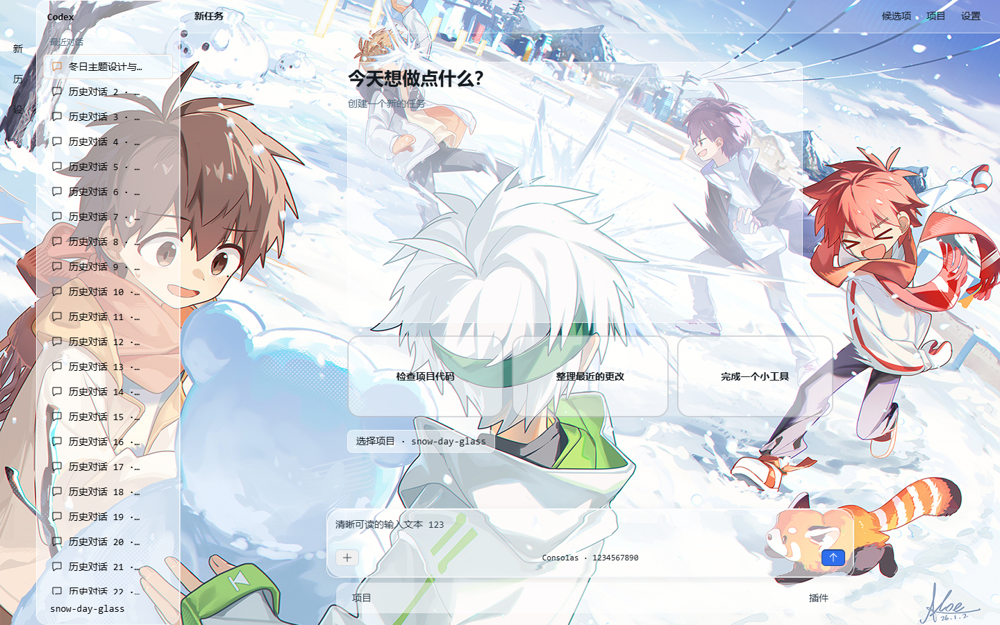

# Snow Day Glass

冬日雪仗氛围的 Codex 桌面主题：贯穿整个窗口的清晰背景、类似 iOS 的悬停玻璃高光、
清晰正文和柔和输入框阴影。v0.10.0 起所有版本只使用本机系统字体，
不携带字体文件或内嵌字体数据。



上图由真实上游 DreamSkin 渲染器在模拟工作区中生成，是设计预览。
ZIP 使用上游 Rust 导入校验器和 Safe CSS 编译器检查。
各版本的实机检查和离线回归范围见对应 QA 文档；用户聊天截图不会上传到仓库。

## 白色蒙版对比

| 版本 | 白色不透明度 | 白色透明度 | 完整安装包 |
| --- | --- | --- | --- |
| A · v0.12.0 | 80% | 20% | [A 完整 ZIP](dist/snow-day-glass-complete-v0.12.0.zip) |
| B · v0.13.0 | 20% | 80% | [B 完整 ZIP](dist/snow-day-glass-complete-v0.13.0.zip) |
| v0.14.0 | 50% | 50% | [0.14.0 完整 ZIP](dist/snow-day-glass-complete-v0.14.0.zip) |
| 当前 · v0.15.0 | 50% | 50% | [当前完整 ZIP](dist/snow-day-glass-complete-v0.15.0.zip) |

各版都将项目、插件页的正文和空白区域一起铺满，保留相同布局与玻璃效果。
标题使用对齐全窗背景的独立底层，挡住滚动文字，避免重复叠白。
聊天消息的 78% 与工具结果的 70% 不透明度保留原设定。
当前默认是 50%。切换比较时，同时导入所选版本的主题 ZIP 并安装同版本增强扩展。
最上方应用标题栏单独使用 **80% 透明度 / 20% 不透明度**，不使用背景模糊。

## 背景图片来源

背景图来自 Pixiv：[https://www.pixiv.net/artworks/139476242](https://www.pixiv.net/artworks/139476242)。
图片权利归原作所有者，本仓库仅为个人用途引用。

## 仓库结构

```text
index.json                       Codex++ 市场清单（含 SHA-256）
themes/snow-day-glass/           Codex++ 主题格式（schemaVersion 1）
dreamskin-package/               DreamSkin 导入包源文件（Safe CSS 协议）
codex-theme/                     完整版 Codex 桌面主题（codex-theme-creator 格式）
  theme.json / theme.css         主题清单与完整样式（系统字体）
  assets/artwork.jpg             背景图
  previews/                      1440x900 与 980x760 预览
scripts/validate.mjs             Codex++ 格式结构校验脚本
extensions/                     官方用户扩展：逐项悬停玻璃、工具正文去模糊、安装及关闭脚本
```

仓库结构参考了 [CodexPlusPlus-Themes](https://github.com/BigPizzaV3/CodexPlusPlus-Themes)
的仓库规范：每套主题带 `LICENSE.md` 素材授权说明、压缩预览图、清单 SHA-256 登记，
并可以直接用它的校验脚本检查本仓库：

```bash
node scripts/validate.mjs
```

## 字体

- v0.15.0 以 0.14.0 为基准，只更新字体。英文、数字等优先使用本机
  `Consolas`，中文使用 `Microsoft YaHei`（微软雅黑），再回退到
  `Microsoft YaHei UI` 和系统等宽字体。
- DreamSkin ZIP 只允许通用字体族，因此指定字体由同版本增强扩展提供。
  不下载、不嵌入、不分发字体。未增加未选中侧栏条目的白色底层。
- 本次仅保存源码与安装包，没有导入或应用到 Codex++。

## 安装

### 交给 AI 一键安装（Codex++）

将下面这段指令发给能访问本机文件、终端和 Codex++ 管理界面的 AI：

```text
请为我安装或更新 Snow Day Glass 主题：
https://github.com/xanthichi/snow-day-glass

先读取仓库 README、extensions/README.md 和 dreamskin-package/manifest.json，
按 manifest.version 获取 dist/snow-day-glass-theme-v<版本号>.zip，以及同版本的
extensions/snow-day-liquid-glass.js、extensions/Install-Glass.ps1 和安装说明。

将文件按仓库目录结构保存到同一个本地安装目录。
我允许你下载、安装并应用该主题和增强扩展。通过我已安装的 Codex++ 官方管理
入口导入主题 ZIP，选中并应用 Snow Day Glass；随后在本地安装目录中运行
pwsh -File extensions/Install-Glass.ps1，
再通过 Codex++ 的“热重载拓展”启用增强效果。更新已有扩展时保留脚本生成的备份。
若下载的是 complete 完整分发包，先解压，再导入其中的 theme ZIP。

保留其他主题、扩展和应用设置，使用官方导入与用户扩展接口完成安装。
完成后确认主题版本、扩展加载状态、输入框与工具栏间距，以及中文显示正常。
如果需要重启 Codex++，先征求我的同意；如果无法自动操作导入入口，请明确
说明原因和最少需要我完成的操作，并准确报告已完成与尚未完成的步骤。
```

这段指令覆盖主题包与增强扩展的完整安装。手动安装步骤见下文。

### Codex 桌面（完整版）

安装 [$codex-theme-creator](https://codexthemes.ai/SKILL.md) 后：

```bash
npx tsx <skill-dir>/scripts/apply-theme.ts apply <repo>/codex-theme
npx tsx <skill-dir>/scripts/apply-theme.ts restore   # 恢复原生外观
```

主题为会话级样式注入，不修改应用本体。

### Codex++（市场格式）

将 `themes/snow-day-glass/` 与 `index.json` 登记项通过 Pull Request 提交到
[CodexPlusPlus-Themes](https://github.com/BigPizzaV3/CodexPlusPlus-Themes)，
这是市场清单格式，不能将该目录直接压缩后当作 DreamSkin ZIP 导入。
市场格式仅携带配色与图片，精确组件样式由增强扩展提供。

### DreamSkin 主题包（Codex++ 内导入）

`dreamskin-package/` 按 DreamSkin Safe CSS 协议组织：`manifest.json`（含文件
SHA-256）、`theme.json`、`theme.css`（`data-ds-part` 安全规则）、
`background.png` 与 `LICENSE.txt`。导入使用
[`snow-day-glass-theme-v0.15.0.zip`](dist/snow-day-glass-theme-v0.15.0.zip)，
选中 v0.15.0 后应用，并更新同版本增强扩展。

**完整的逐项悬停玻璃效果还需官方用户扩展**，因为主题 ZIP 的 Safe CSS 无法
选择历史行、导航项或菜单候选，也无法清理上游工具输出的内部模糊。安装：

```powershell
pwsh -File extensions/Install-Glass.ps1
```

然后在 Codex++ 管理页点“热重载拓展”。禁用使用同一脚本加 `-Disable`，
再点“热重载拓展”。详见 [增强层安装说明](extensions/README.md)。

[`snow-day-glass-complete-v0.15.0.zip`](dist/snow-day-glass-complete-v0.15.0.zip)
包含上述主题包、扩展和安装说明。这个完整分发包需要先解压，不能直接当作
DreamSkin 主题包导入。

重新构建时执行：

```powershell
pwsh -File scripts/build-dreamskin.ps1
```

脚本只压缩五个固定文件，并根据实际文件字节更新 manifest 大小与 SHA-256。
可以通过 `-NativeValidator <path>` 调用真正的上游 Rust 导入解析器。

注意：该协议限制 CSS 只能使用注册的 `data-ds-part` 选择器与白名单属性，
且字体仅允许系统通用字体族，因此 ZIP 不包含内嵌字体。

## 性能与显示

- 侧栏、主区域、长对话容器均不使用常驻模糊；取消整栏悬停阴影和阴影过渡。
- 正文、思考、工具结果、嵌套输出和菜单大容器不使用背景模糊。
- 历史行、导航项、项目选项和菜单候选只在悬停或键盘选中时呈现透明渐变、
  内高光和 SVG 边缘折射。滤镜只处理背景，不扭曲文字。
- 当前侧栏、输入框、菜单和右侧文件窗格使用 `rgba(255,255,255,0.50)` 白色填充，
  即 **50% 透明度**；A 和 B 版分别对应 alpha `0.80` 与 `0.20`。
  用户和助手消息使用 `0.78`，工具输出使用 `0.70`。这些数值是白色层的 alpha，
  不会改变文字、图标或原生隐藏操作的透明度。
- 文件窗格由一层白色底承载，内部编辑器背景透明，保留语法高亮和编辑行为。
- Codex++ 与原生设置页只保留一层共用白色填充，清除内部页面、卡片和导航的
  叠加白底；开关滑块、悬停、选中、禁用和聚焦状态继续使用原生交互。
- Codex++ 页面打开时隐藏其覆盖的原页面内容，透出背景图，避免底层文字重影；
  关闭后恢复原内容，保留布局尺寸。
- 插件等系统页的吸顶标题去掉额外背景模糊，标题、搜索和操作按钮照常显示。
- 项目和插件页的正文及空白区域铺满同版本白色蒙版；标题以同浓度白色覆盖
  对齐全窗的背景图，避免滚动列表文字穿到标题下面。
- 右侧文件窗格贴齐窗口外边框，清除原生 `4px` 外侧槽，保留分栏拖动和内容宽度规则。
- 侧栏文字纯黑；发送、停止、暂停、继续和中止使用蓝色底与白色图标。
- 清除滚动占位层及输入区的原生白色渐变，保留输入框柔和阴影与边缘折射。
- 首页玻璃只绘制在实际输入面；工具栏取消原生 4px 内收并留出 8px 间距，
  边缘不再重叠叠白。
- 原生滚动视口直接结束在输入区上沿，保留底部锚点和输入框点击区，快速滚动时
  不会再出现历史消息先穿透后消失。
- 侧栏四角 `16px`，延伸至应用底部；顶部菜单及文字颜色更深。
- 位移贴图最多缓存 16 个，上限 `256x128`；只在目标或尺寸变化时生成，不跟踪鼠标移动，
  不轮询。滚动不再触发脚本监听或 CSSOM 写入。
- v0.14.0 跳过无位移像素的梯度与法线计算，保留原始位移图像素；输入框缩放复用
  已测尺寸，移除首次绑定的重复准备。性能数据与适用范围见该版本 QA 文档。
- 用 `art.taskMode: full` 让底图贯穿首页、对话和设置；主要内容区不再使用不透明底色。
- 输入框使用 `0 3px 12px rgba(43,58,73,0.09)` 柔和阴影，阅读区保持有色透明底。

DreamSkin 引擎固定使用 `background-size: cover` 铺满窗口，不同窗口比例可能裁剪图片边缘；
ZIP 协议没有 `contain` 设置，不能保证在任意窗口比例中显示全部图片像素。
原生 Codex 完整版使用 `contain`，保留完整构图；窗口比例不同时会留下浅色边带。
测试范围与证据见 [当前 QA](docs/QA-v0.15.0.md)、[0.14.0 QA](docs/QA-v0.14.0.md)、[A 版 QA](docs/QA-v0.12.0.md)
与 [B 版 QA](docs/QA-v0.13.0.md)。

## 设计契约

- 布局模式：`native-immersive`（保留原生几何与交互）
- 背景范围：用户指定的整个应用，单张静态背景，不重复绘制
- 装饰密度：balanced，去掉持续飘雪与整栏动态效果
- 模式：浅色，匹配高亮度参考图
- 玻璃效果：参考 [fu-liquiglass-skill](https://github.com/gerrywrittenhousea76-design/fu-liquiglass-skill)
  的材质层次，并使用 [shuding/liquid-glass](https://github.com/shuding/liquid-glass)
  的 SDF、Canvas 位移图与 SVG 折射思路，参考提交
  `a2d2e847f793430e3409a52927af815a23f4d372`。
- 原项目 MIT 许可保留在 [licenses/shuding-liquid-glass-MIT.txt](licenses/shuding-liquid-glass-MIT.txt)，
  完整分发包也包含该许可。保留 Copyright (c) 2025 Shu Ding。
- 这是浏览器中的边缘折射实现，不包含 Apple 原生渲染器或全屏动态折射。
