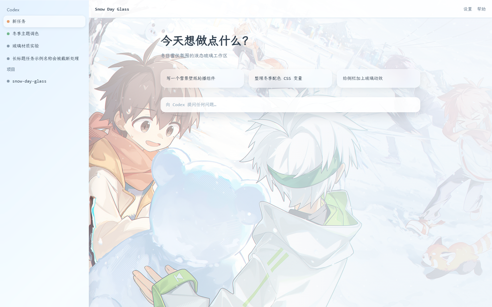

# Snow Day Glass

冬日雪仗氛围的液态玻璃 Codex 桌面主题：冰雪蓝白画布、玻璃侧栏选项卡、
内嵌 [霞鹜文楷 GB](https://github.com/lxgw/LxgwWenKaiGB) 字体（离线可用）。



## 背景图片来源

背景图来自 Pixiv：[https://www.pixiv.net/artworks/139476242](https://www.pixiv.net/artworks/139476242)。
图片权利归原作所有者，本仓库仅为个人用途引用。

## 仓库结构

```text
index.json                       Codex++ 市场清单（含 SHA-256）
themes/snow-day-glass/           Codex++ 主题格式（schemaVersion 1）
codex-theme/                     完整版 Codex 桌面主题（codex-theme-creator 格式）
  theme.json / theme.css         主题清单与完整样式（内置字体 base64）
  assets/fonts/                  LXGW WenKai GB WOFF2 + SIL OFL 1.1 许可证
  previews/                      1440x900 与 980x760 预览
scripts/validate.mjs             Codex++ 格式结构校验脚本
```

完整版主题参考了 [CodexPlusPlus-Themes](https://github.com/BigPizzaV3/CodexPlusPlus-Themes)
的仓库规范：每套主题带 `LICENSE.md` 素材授权说明、压缩预览图、清单 SHA-256 登记，
并可以直接用它的校验脚本检查本仓库：

```bash
node scripts/validate.mjs
```

## 字体

- 中文：`LXGW WenKai GB`（霞鹜文楷 GB）Regular v1.522，以 WOFF2 base64 内置于
  `codex-theme/theme.css`，无需在主机上安装即可使用；授权为 SIL OFL 1.1，
  全文见 `codex-theme/assets/fonts/OFL.txt`。
- 英文与数字：`Consolas`（Windows 系统自带）。Consolas 为 Microsoft 专有字体，
  不随本主题分发；缺失时中文以外的字符回退到系统字体。

## 安装

### Codex 桌面（完整版）

安装 [$codex-theme-creator](https://codexthemes.ai/SKILL.md) 后：

```bash
npx tsx <skill-dir>/scripts/apply-theme.ts apply <repo>/codex-theme
npx tsx <skill-dir>/scripts/apply-theme.ts restore   # 恢复原生外观
```

主题为会话级样式注入，不修改应用本体。

### Codex++（市场格式）

将 `themes/snow-day-glass/` 与 `index.json` 登记项通过 Pull Request 提交到
[CodexPlusPlus-Themes](https://github.com/BigPizzaV3/CodexPlusPlus-Themes)，
合并后即可在 Codex++ 主题市场安装。

## 设计契约

- 布局模式：`native-immersive`（保留原生几何与交互）
- 背景范围：仅首页，文字区有可读性遮罩
- 装饰密度：rich（分层材质、完整 token 覆盖、飘雪氛围层）
- 模式：浅色，匹配高亮度参考图
- 玻璃效果：参考 [fu-liquiglass-skill](https://github.com/gerrywrittenhousea76-design/fu-liquiglass-skill)
  的表面原语，动画只使用 transform/opacity 并尊重 `prefers-reduced-motion`
