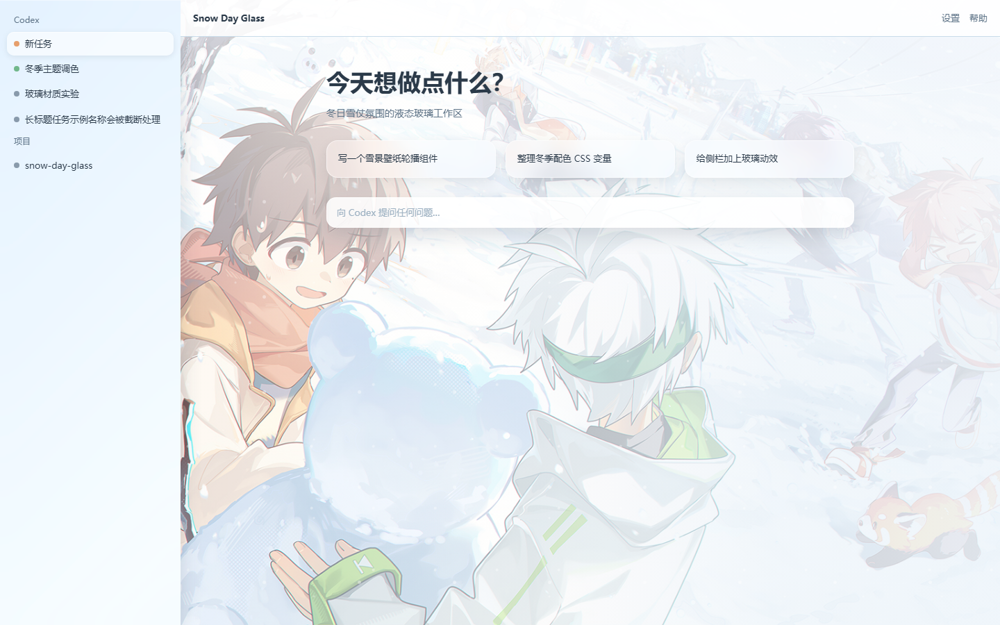

# Snow Day Glass - Codex Desktop Theme

A bright, winter-themed skin for the Codex desktop app, built from an anime
snowball-fight illustration. Icy blue-white canvas, warm scarf-orange accents,
and liquid-glass sidebar tabs with soft blur, saturation, specular highlights,
and gentle hover motion.



## Background Image Credit

The background artwork is from Pixiv:
[https://www.pixiv.net/artworks/139476242](https://www.pixiv.net/artworks/139476242)

All rights to the artwork belong to its original author. This theme is a
personal-use customization that references the artwork as the source material.

## Glass Effect

The sidebar tab treatment follows the liquid-glass surface primitive from
[fu-liquiglass-skill](https://github.com/gerrywrittenhousea76-design/fu-liquiglass-skill):
translucent tint, `backdrop-filter` blur + saturation, a 1px translucent
highlight border, a directional highlight, restrained shadows, and short
transform/opacity-only transitions with `prefers-reduced-motion` fallbacks.

Theme design follows the official
[$codex-theme-creator](https://codexthemes.ai/SKILL.md) skill workflow.

## Files

- `theme.json` - theme manifest (native-immersive, light, background on home)
- `theme.css` - complete theme stylesheet
- `assets/artwork.jpg` - background artwork
- `previews/` - design previews at 1440x900 and 980x760

## Install / Apply

With the `codex-theme-creator` skill installed:

```bash
npx tsx <skill-dir>/scripts/apply-theme.ts apply <path-to-this-folder>
```

The theme is a reversible session style injection; restore the native look any
time with:

```bash
npx tsx <skill-dir>/scripts/apply-theme.ts restore
```

## Design Contract

- Layout mode: `native-immersive` (native geometry preserved)
- Background scope: `home` only, with a readability veil over the text area
- Decor density: rich (layered surfaces, full token sweep, ambient snowfall)
- Mode: light, matching the high-luminance reference artwork
